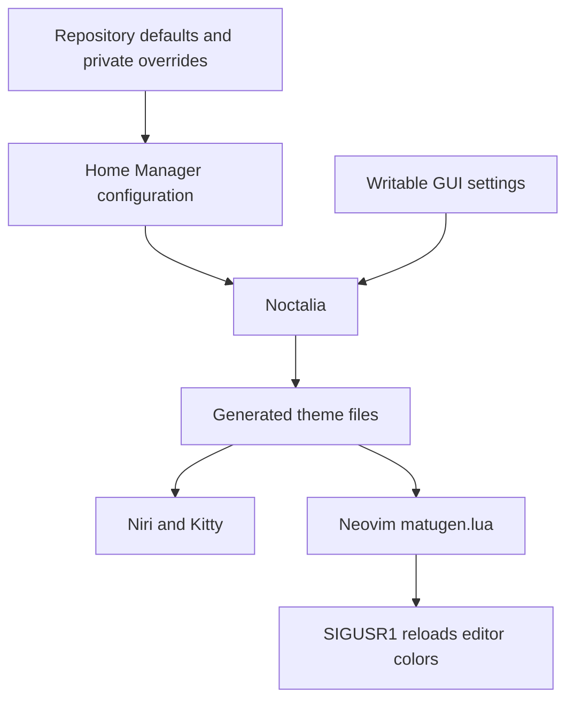

# Noctalia

Noctalia provides the bar, launcher, notifications, clipboard, wallpaper picker
and session controls in Niri.

| Keys in Niri | Action |
| --- | --- |
| `Mod+Space` | Launcher |
| `Mod+S` | Control center |
| `Mod+Comma` | Settings |
| `Mod+V` / `Mod+Y` | Clipboard / wallpapers |
| `Mod+P` | Session menu |
| `Mod+Alt+L` | Lock and suspend |
| `Ctrl+Shift+Escape` | System page in control center |

Volume, media and brightness keys call their tools directly, so they can keep
working while the shell starts. The login screen has its own
[greeter guide](../operations/noctalia-greeter.md).

## Settings and generated colors

Edit [config/noctalia](../../config/noctalia) for shared defaults.
`config.toml` owns shell settings; `bar-common.toml` and `widgets-common.toml`
are shared, while `bar-pc.toml`/`bar-laptop.toml` and corresponding widget files
select each desktop's layout. Host profiles choose
`my.user.desktop.noctalia.profile`.

The [Home Manager module](../../modules/desktop/noctalia/config.nix) turns
TOML defaults into `programs.noctalia.settings`. Private settings can override
personal values there. Avatar, wallpaper and screenshot paths derive from the
home directory by default.

GUI state lives in `~/.local/state/noctalia/settings.toml`. Check it when a GUI
choice appears to override a repository default. Activation contains a narrow,
backed-up cleanup of obsolete settings; it does not make all GUI state
declarative. Do not replace that writable state with a store symlink or erase it
to fix a single setting.

[User templates](../../config/noctalia/user-templates.toml) generate Neovim's
`~/.config/nvim/lua/matugen.lua` and signal running editors. Other generated theme
files feed Niri and Kitty. Change the source/template, then regenerate the palette;
editing generated files is temporary.

## Troubleshooting

If panels do not open, check that the Noctalia user service is running and that
`noctalia msg panel-toggle launcher` can reach it. Review its user journal before
restarting anything. If colors are stale, check palette generation and output
paths first; Neovim falls back to default dark when its generated palette is
missing or invalid. A successful generation still needs a visual check on the
affected desktop.
