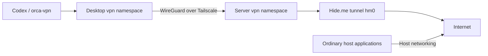

# VPN: use, diagnose and recover

Codex and explicit `orca-vpn` launches use an isolated network namespace on the
PC/laptop. Their traffic crosses WireGuard over Tailscale to the server, then
exits through Hide.me. Ordinary SSH, browser, updates, Docker and normal Orca use
host networking.



The server is the only provider. Desktop clients have no local provider or
host-network fallback. If the tunnel, DNS, firewall or readiness fails, isolated
apps remain blocked. A normal Orca process may capture another invocation through
single-instance behavior; check the actual process when using `orca-vpn`.

## Check status first

Use a normal host terminal on each affected machine:

```sh
vpn-status
vpn-status --verbose
readlink -f /run/current-system
systemctl show netns-vpn.service netns-vpn-shared.service \
  -p LoadState -p ActiveState
sudo /etc/network-namespaces/vpn-check
```

`vpn-status` is read-only and does not need sudo or a desktop session. It shows
sanitized local evidence, unit states, probe results and retained failures. A
client cannot diagnose the provider's account; inspect the server through the
existing authenticated host SSH/console session. A Tailscale ping proves neither
a WireGuard handshake nor provider egress.

On the server:

```sh
systemctl show hide-me-vpn.service netns-vpn-underlay.service netns-vpn-dns.service \
  -p LoadState -p ActiveState
systemctl status tailscaled.service netns-vpn-recovery.timer --no-pager
```

On desktops, `hide-me-vpn.service` and `netns-vpn-underlay.service` must remain
masked/inactive. These persistent masks also protect older generations. Never
unmask them as a recovery shortcut.

### Read the result

`Applications` reports `READY`, `BLOCKED`, `DEGRADED` or `UNKNOWN` separately from
`Routing policy: fail-closed` and scheduler activity. READY needs a fresh success,
unexpired IPv4 marker and active required units; every launch still checks the
local routes, nft policy, resolver and handshake. A failed launch says BLOCKED
even if a previous scheduled probe passed. Partial probe success can be DEGRADED
while IPv4 readiness is fresh. A snapshot older than 120 seconds is stale.

| Reason | Next step |
| --- | --- |
| `DEPLOYMENT_MISMATCH` | Compare installed generation and required units. A watchdog cannot install missing units. |
| `DISABLED`, `STOP_INTENT_UNKNOWN` | Check maintenance, masks and stop intent before an explicit start. |
| `CONFIGURATION_ERROR`, `SECRETS_UNAVAILABLE` | Check secret provisioning and peer declarations privately; never print values. |
| `NAMESPACE_UNAVAILABLE` | Inspect startup/dependencies before drawing firewall conclusions. |
| `HOST_OFFLINE` | No usable family route/interface and host HTTPS probes failed. |
| `HOST_CONNECTIVITY_UNVERIFIED` | Host HTTPS failed with usable/unknown routes; DNS, TLS, filtering or endpoints remain possible. |
| `TAILSCALE_OFFLINE`, `GATEWAY_UNREACHABLE` | Check host authentication, gateway power/uplink and tailnet reachability. |
| `TRANSPORT_MISSING`, `WG_HANDSHAKE_STALE` | Inspect `shared0`, endpoint, peer keys and UDP filtering. |
| `UNDERLAY_UNAVAILABLE`, `PROVIDER_UNHEALTHY` | Inspect the gateway component and bounded recovery. |
| `AUTH_REJECTED` | Provider reported HTTP 401/403; exact cause is unknown. Verify privately below. |
| `PROVIDER_RATE_LIMITED`, `PROVIDER_API_UNAVAILABLE` | HTTP 429 or 5xx; keep distinct from rejected authorization. |
| `DNS_UNAVAILABLE` | Inspect private DNS. Never substitute host/public DNS. |
| `CLOCK_ERROR` | Check time before repair. |
| `FIREWALL_ERROR`, `ROUTE_ERROR` | Inspect namespace policy, forwarding/NAT and family routes. |
| `EGRESS_UNAVAILABLE`, `EGRESS_DEGRADED` | Check individual probe outcomes before assigning a cause. |

Common curl results: `0` success, `6` DNS, `7` connection, `22` HTTP response,
`28` timeout, `35`/`60` TLS. One failed family does not prove its whole uplink is
down. A TLS error alone cannot distinguish clock, certificate or endpoint issues.

Use sanitized systemd errors, namespace routes, handshake timestamps, resolver
mapping and nft chains to correlate all three hosts. Do not publish tokens, peer
associations or raw provider logs. Avoid speculative service restarts.

## Automatic recovery

The shared recovery timer runs 15 seconds after boot, then 30 seconds after each
completed run. It requests isolated HTTPS probes for both families against GitHub
and Cloudflare. Launches require a successful IPv4 probe within 90 seconds plus
fresh local checks. A brief failure preserves a success only until its original
expiry. These probes cannot establish every application's API health.

Recovery waits through missing host Internet, Tailscale, gateway and SOPS
prerequisites. It never restarts Tailscale or infers a remote authorization problem.
After 120 seconds of boot/start/resume grace it requires three consecutive failed
observations. Ten healthy minutes replenish the repair budget; one successful
observation resets only the failure debounce.

Repairs target proven local faults: missing/failed `shared0`, gateway `tap0` and
its main-table route, provider interface/routes or stale provider handshake.
A stale client handshake alone does not justify recreating its interface.
Sustained independent DNS/connect/timeout failures across all probes can trigger
a provider-only restart. One failed destination/family, HTTP response errors and
TLS errors cannot. DNS relay repair requires successful isolated upstream HTTPS
and a failed direct relay probe.

At most three component repairs occur per unhealthy episode, with
120/300/900-second minimum backoff. Each component also has a three-start/300-second
systemd limit. Restart success means VERIFYING; only a later isolated probe proves
recovery. Exhaustion stays in `RECOVERY_COOLDOWN` until sustained health or an
operator reset. The provider orders after the underlay and its route; guarded
underlay repair starts both in one ordered transaction.

Recovery respects recorded manual stops and maintenance. Boot-tagged root-owned
`stops/` records distinguish direct stops from dependency stops; old timestamps
alone do not. Missing lifecycle evidence yields `STOP_INTENT_UNKNOWN`. Missing or
failed namespace startup can receive a start, never automatic teardown. Missing
secrets wait; empty/unreadable secrets are errors. Broken firewall/forwarding,
invalid peers, missing units and masks require operator action. There is no
automatic rebuild, unmask, secret replacement or firewall repair.

HTTP 401/403 and 429 stop the reconnect loop and persist a private recovery hold
across reboot. No unattended login or extra token-refresh command runs. Without
reliable Retry-After evidence, rate limits require review. HTTP 5xx receives
bounded backoff; generic timeouts never become an authentication diagnosis.

## Maintenance and authorization holds

These commands change recovery state. Use them only in an approved maintenance
window, with independent host SSH/console and a known-good generation. Mark
maintenance before stopping partially failed or restarting units:

```sh
sudo touch /var/lib/network-namespaces-vpn/maintenance
# Perform approved maintenance.
sudo rm /var/lib/network-namespaces-vpn/maintenance
```

After checking the cause, clear repair counters and an authorization hold with:

```sh
sudo /etc/network-namespaces/vpn-recovery-reset
```

Reset does not start units, replace tokens or bypass readiness. Recovery may
resume a provider it stopped itself; a recorded operator stop still needs an
explicit start. Unchanged SOPS bootstrap seeds preserve refreshed mutable tokens.
Changed seed/token contents can release a hold, and a fresh provider invocation
must verify recovery. Old invocation errors cannot re-create that released hold;
a new attempt's rejection can. Health, not start completion, clears it.

For rejected authorization, verify account status privately with Hide.me. Payment
renewal and token renewal are separate; 401 does not establish expiry. Only create
a fresh bootstrap after confirming credentials need renewal, using
[private authentication](network-namespaces.md#private-server-authentication).
Never overwrite a valid refreshed token with an old SOPS seed.

## Change, deploy and verify

[Namespace primitives](network-namespaces.md) explains filters, provider
credentials and the restricted app registry. Host profiles select roles; private
host overrides supply real endpoints and peer associations. Implementation lives
in [namespace modules](../../modules/services/network-namespaces/), with
[tests](../../tests/network-namespaces/) and [provider packaging](../../packages/hide-me/).

Use the reviewed private input from [deployment](deployment.md) for affected-host
builds and checks. The dedicated non-activating harness is:

```sh
nix run .#shared-vpn-test --no-write-lock-file
```

Fixtures do not prove real provider recovery, DNS containment or hardware resume.
Activation can interrupt isolated processes. Preserve persistent desktop masks,
normal host SSH and the known-good public/private revision pair.

Live acceptance requires a separate approved window. Capture sanitized status on
all three hosts, verify ordinary host Internet/SSH, and confirm that retained
isolated sessions cannot leak IPv4, IPv6 or DNS during each outage:

| Exercise | Expected result |
| --- | --- |
| Reboot each client; boot before gateway; delayed WAN/Tailscale/SOPS | Wait for prerequisites, then recover isolated launches. |
| Gateway reboot; separately approved suspend/resume | Clients remain blocked, then recover; investigate unexpected sleep privately. |
| WAN outage; Tailscale stop/logout; blocked shared UDP | Correct host/peer diagnosis; no broad networking restart. |
| Missing shared interface or failed DNS relay | Repair only the proven component and verify with fresh isolated probes. |
| Frozen provider or lost private resolver | Bounded provider recovery preserving token and filter state. |
| Safe recorded auth-rejection fixture | Durable hold and prompt launch refusal; never manufacture rejection by rotating live secrets. |
| Failed destination/family; exhausted budget; maintenance/reset | Degraded results stay distinct, no restart storm or override of deliberate stops. |

Reboot/resume, real IPv4/IPv6/DNS containment and provider recovery remain checks
for the target hosts, not conclusions available from source or mock tests.
