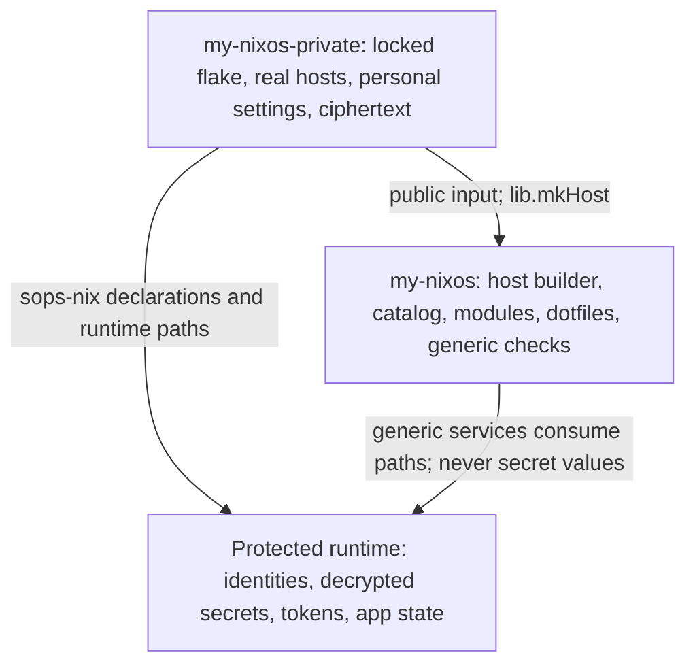

# Public/private migration contract (M01)

Specification for [issue #28](https://github.com/evgen2571/my-nixos/issues/28),
audited on 2026-10-18 at `5296a1759e6c1f53e22f55b60400b41c1d25bf4c`.
This is a proposed migration, not a completed split or permission to publish.
Only planning documentation changes in M01. Configuration, ciphertext, generated
files and mutable runtime state stay unchanged.

The [architecture](../ARCHITECTURE.md), [module conventions](modules.md),
[SOPS guide](sops.md), [server guide](server.md),
[VPN gateway guide](shared-vpn-gateway.md) and
[namespace guide](network-namespaces.md) remain authoritative operational guides.
Some SOPS prose predates the current files: active declarations use
`secrets/hosts/*.yaml`, not the historical `secrets/vpn/*.yaml`; current policy
also includes admin-only bootstrap documents. Follow executable declarations.

## Ownership and dependencies



The public flake has no dependency on the private repository. The private flake
owns all three existing `nixosConfigurations` names and consumes public code.
Public-alone evaluation requires no personal host, SOPS identity or private URL.
Private source is still copied into the Nix store during evaluation: a private
Git repository is not a safe place for plaintext credentials.

Classifications below are policy decisions, not claims that every private file
contains a secret:

- **Public:** reusable implementation or synthetic fixtures.
- **Documented public:** public data or opinionated defaults, with their purpose
  explained; no credential privileges follow from possession alone.
- **Private personal:** identity, deployment choices, hardware/topology facts or
  account metadata; ordinary Nix configuration, not SOPS plaintext.
- **SOPS ciphertext:** encrypted credential/identity material; keep encrypted in
  private Git. Recipients and encryption metadata are public cryptographic data.
- **Runtime-only secret/state:** never tracked in either repository. This includes
  non-secret mutable databases and recovery state as well as actual credentials.

## File migration inventory

`P:` means the public `my-nixos` root; `S:` means `my-nixos-private`.
`R:` means protected paths on the relevant machine. Same-path destinations retain
existing layout. A directory row covers its remaining files after more specific
rows; brace lists enumerate each file with the same decision. New destinations
are proposals and do not exist yet. Do not copy personal values into examples.

| Current path | Proposed repository/path | Classification | Justification | Consumer / migration impact |
| --- | --- | --- | --- | --- |
| `flake.nix` | P: same; S: new `flake.nix` | Public / private personal | Public dependencies are reusable; real host assembly belongs to S | P exports builder; S keeps the three output names and pins P |
| `flake.lock` | P: same; S: independently generated `flake.lock` | Documented public / private personal | Pins public dependencies; private lock also records composition revision | Preserve dependency revisions initially; do not copy stale lock nodes blindly |
| `flake/hosts.nix` | P: same, export builder; S: `flake/hosts.nix` real host calls | Public / private personal | Existing `mkHost` is the reusable seam | Remove real-host imports from P only after S evaluates |
| `flake/verification.nix` | P: generic registrations; S: real-host registrations | Public / private personal | Two registrations consume `self.nixosConfigurations` | Move production-profile registrations to S; retain generic tests in P |
| `flake/{devshells,formatting}.nix` | P: same | Public | Tooling has no personal input | S may reuse P formatter/dev shell outputs |
| `lib/{module-catalog,module-discovery,config-paths}.nix` | P: same | Public | Reusable discovery and source adapters | Resolve defaults relative to P; preserve directory-with-`default.nix` discovery |
| `hosts/pc/configuration.nix` | S: same | Private personal | Account/Git identity, boot settings and trust choices | Replace public core imports; preserve stateVersion, groups and partitions |
| `hosts/pc/hardware-configuration.nix` | S: same | Private personal | Filesystem UUIDs and hardware facts are identifying, not credentials | Move unchanged; never regenerate during split |
| `hosts/pc/profile.nix` | S: same | Private personal | Feature selection, peer endpoints, profile names | Preserve client role, DNS, app registry and user settings |
| `hosts/pc/secrets.nix` | S: same | Private personal | Credential declarations/paths, not plaintext | Preserve ownership, modes, neededForUsers and restart units |
| `hosts/laptop/configuration.nix` | S: same | Private personal | Account/Git identity and machine boot/login choices | Preserve fingerprint/PAM decisions and stateVersion |
| `hosts/laptop/hardware-configuration.nix` | S: same | Private personal | Hardware facts and filesystem identifiers | Move unchanged |
| `hosts/laptop/profile.nix` | S: same | Private personal | Client routing and personal app/profile selection | Preserve WireGuard-only client role and per-host HM settings |
| `hosts/laptop/secrets.nix` | S: same | Private personal | Runtime credential declarations | Preserve password/hash and key paths; no decryption during migration |
| `hosts/server/configuration.nix` | S: same | Private personal | User authorization and wake/suspend policy | Replace core imports; retain gateway suspend guard and SSH access |
| `hosts/server/hardware-configuration.nix` | S: same | Private personal | Real hardware/storage identifiers | Move unchanged |
| `hosts/server/profile.nix` | S: same | Private personal | Storage device, gateway peers and service exposure | Preserve `/srv/*` boundaries, provider and firewall choices |
| `hosts/server/secrets.nix` | S: same | Private personal | Gateway key/bootstrap declarations | Preserve runtime paths and restart behavior |
| `hosts/common/desktop.nix` | S: same | Private personal | Shared personal feature selection, not reusable service logic | PC/laptop keep explicit import and original declaration priority |
| `hosts/common/actline-development.nix` | S: same | Private personal | Development aliases, topology and trust selection | Keep desktop-only import; no server CA trust added |
| `hosts/common/certs/actline-dev-rootCA.pem` | S: same | Private personal (public certificate) | Public CA certificate reveals private development identity; not a signing key | Preserve desktop trust; CA private key remains outside Git |
| `hosts/vpn-public-keys.nix` | S: same | Private personal (public keys) | WireGuard public identities expose peer associations, not private keys | Preserve peer bindings on all three hosts |
| `home/evgen2571/home.nix` | P: `home/default.nix`; S: optional private base module | Public after neutral rename | Contents are generic session path/state defaults; account-specific path is unnecessary | Change `my.primaryUser.home.module` default in P; preserve current home stateVersion |
| `modules/system-core/user.nix` | P: same | Public | Already parameterizes account, authorization and Git identity | Replace personal home-module default with P `home/default.nix` |
| `modules/system-core/{common,server}.nix` | P: same; personal locale defaults explicitly retained in S | Documented public | Boot/package/cache policies reusable; locale/timezone are preferences | Neutralize personal timezone/keyboard defaults in P; S restores exact current values |
| `modules/secrets.nix` | P: same | Public | Generic age runtime path/generation policy, no private identity | Builder retains sops-nix integration; S owns declarations |
| `modules/user-dev/ssh.nix` | P: generic SSH setup; S: `home/ssh.nix` personal settings | Public / private personal | Host-name branching, private key paths, server alias/user are personal | Remove personal match blocks/agent selection from P; set via host HM settings using native SSH options; preserve keepalive policy |
| `modules/user-dev/git.nix` | P: same | Public | Identity already comes from options | S supplies current identity and public signing key through primary-user adapter |
| `modules/system-services/syncthing.nix` | P: same | Public | Paths derive from primary user; no device IDs configured here | Preserve mutable Syncthing databases and device enrollment |
| `modules/server/` | P: same | Documented public | Reusable SSH, Docker, storage and Syncthing behavior | S supplies storage device/selection; document `/srv/storage` separately from siblings |
| `modules/system-services/network-namespaces/` except migration bundle below | P: same | Documented public | Reusable isolation/recovery, runtime path interfaces; defaults are not private credentials | Preserve fail-closed routing, IPv4/IPv6, DNS, lifecycle and provider separation |
| `modules/system-services/network-namespaces/migration/{prepare-rollback,rollback,desktop-provider-guard}.sh` | P: same | Documented public | Guard and reviewed rollback bundle are used by generic VM tests; allowlisted host labels alone are acceptable public examples | Keep bundle intact for VM fixture and compatibility wrapper; S runbooks call pinned P scripts; never execute without live-operation approval |
| `modules/system-services/vpnbook-wireguard-failover.nix` | P: same | Documented public | Service consumes protected external config files; no embedded provider keys | No connection to shared Hide.me route; preserve separation |
| Remaining `modules/`, `packages/`, `pkgs/` | P: same | Public | Reusable integrations and pinned packages | Retain `my.*` namespaces, existing dependencies and relative public imports |
| `config/zen/chatgpt-projects.nix` | S: same | Private personal | Account/project URLs and pin IDs expose metadata, not login credentials | Private profile imports it; no account URLs in P examples |
| `config/zen/profile.nix` | S: same; P: sanitized same-path default | Private personal / public | Workspaces, project links, routes and profile UUIDs are personal | P keeps only neutral settings; S supplies full `programs.zen-browser.profiles.default` via host HM settings; preserve UUIDs and non-forcing semantics |
| `modules/user-apps/zen-browser.nix` | P: same | Public | Reusable browser install/profile-path adapter | Default public profile must merge without conflicting with S native profile settings |
| `config/noctalia/config.toml` | S: same; P: sanitized same-path default | Private personal / public | User, weather/location and local media paths need privacy handling | S uses existing `my.user.desktop.noctalia.configFile`; never reset generated settings |
| `config/noctalia/v4/{settings.json,plugins.json,user-templates.toml}` | S: same; P: sanitized same-path legacy defaults | Private personal / public | Legacy config still contains user/path/plugin selections | Preserve opt-in legacy installer through private `configPaths` override if used |
| Remaining `config/noctalia/` | P: same | Documented public | Generic bars, widgets, templates and pruning implementation | Keep PC/laptop variant files as documented examples; S chooses profile |
| `config/niri/sub/{outputs.kdl,workspaces-pc.kdl,workspaces-laptop.kdl}` | P: sanitized examples; S: same-path originals | Private personal / documented public | Display facts/layout choices, not credentials | Use existing `configPaths.wm.niriConfigDir` and adapter override for exact private layout |
| `config/hyprland/sub/outputs.conf` | P: neutral fallback; S: same-path original | Private personal / public | Mirrored monitor layout | Override existing Hyprland config-path adapter for S if enabled |
| Remaining `config/` including `config/sesh/sesh.toml` | P: same | Documented public | Generic app/editor preferences; sesh uses home-relative paths, no real project inventory | Keep behavior; scan future edits for personal URLs/absolute paths |
| `config/fish/conf.d/openrouter.fish` | P: same | Public | Reads a runtime secret; contains no API key | Keep `/run/secrets` interface; never substitute secret contents during evaluation |
| `config/fish/conf.d/nixos-hosts.fish` | P: same | Public | Commands accept an explicit host and current checkout | Document execution from S for real hosts |
| `.sops.yaml` | S: same; P: documentation example only | Private personal (public recipients) | Admin/host recipient associations are metadata | Keep rules and recipient sets unchanged; no rekey needed for same relative paths |
| `secrets/hosts/pc.yaml` | S: same | SOPS ciphertext | Host credentials encrypted to admin + PC | PC declarations follow file move; no decrypt/re-encrypt |
| `secrets/hosts/laptop.yaml` | S: same | SOPS ciphertext | Host credentials encrypted to admin + laptop | Laptop declarations follow file move |
| `secrets/hosts/server.yaml` | S: same | SOPS ciphertext | Gateway credentials encrypted to admin + server | Server declarations follow file move; preserve refreshed runtime token |
| `secrets/bootstrap/pc.yaml` | S: same | SOPS ciphertext | Recovery identity material, admin-only recipient | Keep recovery separate from host-readable ciphertext |
| `secrets/bootstrap/laptop.yaml` | S: same | SOPS ciphertext | Recovery identity material, admin-only recipient | Same restriction |
| `secrets/bootstrap/server.yaml` | S: same | SOPS ciphertext | Recovery identity material, admin-only recipient | Same restriction |
| `secrets/{README.md,.gitkeep,hosts/.gitkeep}` | P: generic policy/examples; S: matching storage guidance/placeholders | Public | Policy text is useful; current presence claims need correction | P has no personal ciphertext; S guide describes actual files |
| `keys/users/evgen2571/{pc.pub,laptop.pub}` | S: same | Private personal (public keys) | Public login keys/comments link account and devices | Preserve server authorized-key files; no key rotation merely for relocation |
| `keys/{README.md,hosts/.gitkeep}` | P: same, examples sanitized | Public | Public-key policy and empty host-key placeholder | No private key should ever be added |
| `tests/niri/hosts.nix`, `tests/network-namespaces/hosts.nix` | S: same | Private personal | Assertions depend on real production selections | S imports its own configurations; P retains synthetic module coverage |
| `tests/network-namespaces/activate-laptop.sh` | S: same | Private personal | Live deployment helper bound to the real laptop | Remains approval-only, never a public automated check |
| `tests/network-namespaces/prepare-shared-rollback.sh` | P: same | Public | Generic caller of rollback support with supplied system paths | Private operational use references the intact pinned P migration bundle |
| Remaining `tests/`, including `tests/network-namespaces/{systemd.nix,public-keys.nix}` | P: same | Public | VM fixtures use synthetic peers/runtime-generated keys, not deployed identities | Generic VM host labels can remain documented; preserve runtime-only fixture private keys |
| `justfile` | P: generic recipes without real default host; S: current host aliases/default | Public / private personal | Current recipes target real output names | Real build/deploy commands run from S |
| `docs/archive/{server-initial-setup-notes,shared-vpn-gateway-implementation-plan,shared-vpn-initial-rollout-runbook}.md` | S: same | Private personal | Historical deployment/topology context survives in docs | Update public incoming links; do not present archives as current operating truth |
| `.agent/vpn-resilience-plan.md` | S: same | Private personal | Incident and rollout history | No public implementation dependency |
| `docs/{desktop-host-defaults,obsolete-configuration-audit}.md` | S: same | Private personal | Historical host selections and paths | P retains only reusable architectural explanations elsewhere |
| `docs/{server,shared-vpn-gateway,network-namespaces,sops,zen-browser}.md` | P: sanitized generic guides; S: `docs/operations/` host-specific extracts | Public / private personal | Instructions useful publicly; real topology, profile IDs and operational evidence private | Update links/import examples for composition; do not duplicate whole guides |
| `README.md`, `AGENTS.md`, `ARCHITECTURE.md`, `docs/{modules,task-routing}.md`, `docs/agents/` | P: generic guidance; S: host-specific guidance | Public / private personal | Current docs assume three real hosts and personal paths | Update ownership and command entry points in coordinated migration |
| `docs/public-private-migration.md` | S: same after split; P: short generic composition guide | Private personal | This inventory itself enumerates deployment paths | Keep detailed audit out of eventual public snapshot |
| Remaining `docs/`, `.gitignore`, `.clang-format` | P: same after example/link review | Documented public | Reusable guidance/tooling | Replace personal usernames in examples; remove dangling private-only links |
| Git author/committer identities, old paths and deleted revisions | Existing restricted archive; publication decision below | Private personal / possibly credential-bearing history | Deleting HEAD files does not remove history | Gate publication on separate history policy and scan |
| `/var/lib/sops-nix/key.txt`, admin age identity, private SSH/CA/WireGuard keys | R: existing protected locations | Runtime-only secret | Actual authentication/decryption/signing capability | Never inspect/copy into Nix expressions, either repo or logs |
| `/run/secrets*`, provider bootstrap/refresh tokens, external VPNBook configs | R: existing protected locations | Runtime-only secret | Decryption output and active credentials | Preserve owners/modes; no token replacement for repository migration |
| Browser logins/databases, Skillshare resources, Syncthing state, `/srv/*` data, VPN hold/lifecycle state | R: existing locations | Runtime-only secret/state | Machine/app-managed data, not reproducible source | Back up privately where appropriate; never delete because imports moved |

## Minimal composition contract for M02

**Choose exported host builder plus catalog profiles.** Keep the existing
`mkHost { hostModule; profile; system ? "x86_64-linux"; extraModules ? [];
extraSpecialArgs ? {}; }` signature. Export it as `lib.mkHost` and export
`lib.moduleProfiles.{desktop,server}` from public `flake/hosts.nix`. Keep
flake-parts `withSystem` and the captured **public** inputs. Do not rebuild the
assembler in S or pass S's inputs as the builder's `inputs` argument.

Also export direct aliases to existing core files:
`nixosModules.{common,server,primaryUser}` for
`modules/system-core/{common,server,user}.nix`. These roots are intentionally
outside catalog discovery. The builder continues importing `modules/secrets.nix`,
Home Manager and sops-nix exactly once. All other module roots retain catalog
ownership; hosts must not manually import discovered files.

Private flake outline (proposed API, not available on the audited revision):

```nix
{
  inputs.public.url = "github:evgen2571/my-nixos";
  outputs = { public, ... }: {
    nixosConfigurations = {
      nixos-pc = public.lib.mkHost {
        hostModule = ./hosts/pc/configuration.nix;
        profile = public.lib.moduleProfiles.desktop;
        extraSpecialArgs.public = public;
      };
      nixos-lp = public.lib.mkHost {
        hostModule = ./hosts/laptop/configuration.nix;
        profile = public.lib.moduleProfiles.desktop;
        extraSpecialArgs.public = public;
      };
      nixos-server = public.lib.mkHost {
        hostModule = ./hosts/server/configuration.nix;
        profile = public.lib.moduleProfiles.server;
        extraSpecialArgs.public = public;
      };
    };
  };
}
```

Private host modules accept `{ public, ... }` and replace relative public core
imports with `public.nixosModules.common` (desktops) or `.server`, plus
`.primaryUser`. Hardware/profile/secrets imports remain relative inside S.
Keep host user settings under `my.primaryUser.home.settings`; private modules
such as `home/ssh.nix` are imported there. Secret declarations keep relative
SOPS file paths wholly within S. No runtime key is needed for evaluation.

`specialArgs` are available while resolving NixOS imports. The existing builder
also forwards them through `home-manager.extraSpecialArgs`; catalog home modules
stay in `home-manager.sharedModules`. This is why a private `public` source
argument works in both contexts without `_module.args` import recursion.
`inputs`, `inputs'`, `self'` and default `configPaths` retain public scope.
Reserve those names; override only `configPaths` deliberately, never `inputs`.

Where exact private dotfile content must differ, use existing native options
first (Noctalia `configFile`, Zen profile definitions). For directory adapters,
pass one private `extraSpecialArgs.configPaths` made from
`import (public.outPath + "/lib/config-paths.nix") { root = public.outPath;
lib = public.inputs.nixpkgs.lib; }`, updating only needed `wm` paths and
`dotfileAdapters.niri`/`.hyprland` defaults together. These adapter closures
capture their original paths: overriding `wm` alone does not redirect them.
Private Niri/Hyprland directories must contain the full required source tree;
keep reusable siblings from the pinned P source, never reference `../my-nixos`
implicitly or duplicate service/module code. Do not introduce a generic overlay
framework. Retain writable Neovim/Matugen, browser and Skillshare boundaries.

Alternatives considered:

| Alternative | Decision against current assembly |
| --- | --- |
| Export only NixOS/HM modules | Technically valid, but S must duplicate catalog, arguments, HM and SOPS wiring; reject as primary contract |
| Extend exported real hosts with `extendModules` | NixOS supports it, but base real hosts keep private data in P; generic bases add override/removal complexity; reject |
| Private input in public flake, or impure sibling imports | Breaks public-alone evaluation/purity; reject |

The builder contract was checked against the locked NixOS `specialArgs`/
`extendModules` and HM `extraSpecialArgs`/`sharedModules` implementation. A
scratch evaluation exports the current builder without changing repository Nix
files and composes synthetic desktop/server users with a caller-supplied source
argument. This verifies the seam; it does not validate a completed two-repo split.

## Public-alone usability and checks

P exports `lib.mkHost`, `lib.moduleProfiles`, the three core module aliases,
formatter, dev shell, generic checks and existing generic test app. It exports
**no real hosts and no deployable default host**. Document a small synthetic
consumer in the public README, with fake username, caller-owned hardware/base
module, explicit state versions and all personal services disabled. An empty
`nixosConfigurations` set is acceptable; evaluating the builder consumer is part
of acceptance so empty outputs cannot hide a broken API.

A fresh authenticated-free public clone must pass:

```sh
nix flake show --no-write-lock-file
nix flake check --no-build --no-write-lock-file
nix flake check --no-write-lock-file
```

The second command only evaluates checks; the third executes/builds registered
checks including the VM tests where supported. Keep synthetic VPN/systemd,
launcher/recovery, config-path checks and Neovim smoke sources public. S owns
`niri-host-profiles` and `shared-vpn-host-profiles`, importing the moved tests
with S's `nixosConfigurations` and P's pinned nixpkgs. Keep their assertions;
do not simply delete production coverage. No new CI phase is required.
Neovim smoke checks remain a separately provisioned local check.

## Local development and reproducible inputs

Create S as a private sibling checkout, not a subdirectory or submodule of P.
Before any push, verify its exact owner/name and `isPrivate`/`visibility` using
`gh repo view OWNER/my-nixos-private --json nameWithOwner,isPrivate,visibility`.
The current origin was verified PRIVATE during M01; S does not yet exist as part
of this task. Repository creation, visibility changes and live deployment are
separate operations outside this phase.

Commit S's `flake.lock` against an accessible remote P revision exporting the
contract. Once P is public, downstream users need no credentials for it; before
then collaborators need access to both repositories. Cloning S always needs
authorized Git credentials. Use an SSH agent/credential helper, never credentials
in URLs, flake inputs or lock files. Keep P's existing dependency pins initially;
S need not independently declare nixpkgs or Home Manager. Private tests use
`public.inputs.nixpkgs` to avoid unintended duplicate dependency versions.

For an uncommitted public change, run from S:

```sh
nix eval --raw .#nixosConfigurations.nixos-lp.config.system.build.toplevel.drvPath \
  --override-input public ../my-nixos --no-write-lock-file
nix build --no-link .#nixosConfigurations.nixos-lp.config.system.build.toplevel \
  --override-input public ../my-nixos --no-write-lock-file
```

A local Git flake includes tracked modifications, but not untracked/ignored
files; stage intended new files before evaluation. Review `git status` in both
repos. A deliberate `path:../my-nixos` override copies the directory source more
broadly, including untracked files; avoid it for repositories with private local
material. Do not use `--impure` to reach a sibling from Nix code. Explicit CLI
input overrides preserve the dependency boundary; `--no-write-lock-file` keeps
local paths out of the committed lock. Before delivery, commit P, update only
S's public lock node to that revision (`nix flake update public`), review the
lock diff, and repeat validation without overrides. Never claim a local override
is the reproducible release input. If a branch URL is temporarily needed before
merge, pin/review it and repin S to the merged public revision before release.

## History audit and publication gate

M01 inspected all 365 commits reachable from local refs in a non-shallow checkout
and 1,343 distinct reachable blobs (about 4.4 MB). A bounded pattern scan checked
private-key markers, common provider token shapes and literal credential
assignments without printing matched values. Six assignment candidates were
triaged as runtime path references, including the VM token-file path. A separate
check of 16 historical YAML blobs found 44 encrypted top-level fields and one
empty field, with no nonempty plaintext top-level secret fields. Current six
secret documents have encrypted data fields; bootstrap files have one recipient,
host files two, matching the inspected policy. Nothing was decrypted. No
confirmed plaintext credential was found by these checks.

This is **not security clearance**: pattern scans miss arbitrary credentials,
nested data and unusual formats; local refs exclude unfetched/deleted remote
refs, PR refs, forks, artifacts and caches. Public SSH/WireGuard keys, CA
certificates, SOPS recipients/ciphertext, filesystem UUIDs, tailnet addresses,
account/project URLs and Git author/committer identities are separate metadata
exposure classes. Moving HEAD files does not hide any historical versions.
Historical `secrets/vpn/*.yaml` and older public-key paths also need history policy.
Do not reintroduce those obsolete paths during the move.

Recommended publication policy: retain the original full history in a restricted
archive and publish a reviewed, sanitized new-root snapshot as P, with provenance
that omits private values. If preserving P's existing history is required, agree
an explicit `git filter-repo` path/content/author cleanup and force-push/reclone
plan first. Both options need a separate decision and publication approval; M01
does neither. Include branch/tag/PR refs, release attachments, GitHub issues,
actions artifacts/logs and cached copies in that follow-up audit. This plan and
its private inventory should remain in the restricted archive/S.

If a later scan finds an actual credential, stop publication and report only its
location/type via the owner's private channel; never paste its value or raw scan
output into Git, issues or PRs. Privately revoke/rotate the credential and assess
use first. History cleanup is separate and cannot revoke copied credentials.
Public keys/certificates alone do not require rotation; loss of a private key does.
Recipient changes require SOPS rekey review and cannot revoke old ciphertext.

## M02 implementation checklist, evidence and rollback

One migration owner coordinates the pair of PRs; a security/operations reviewer
checks privacy, access and storage/VPN invariants. P's PR owns exports,
neutral defaults, generic tests and public docs. S's PR owns host/data moves,
production-profile checks, lock update and private runbooks. Review together;
merge the additive P API first, pin S to that commit, and validate S before
removing P's real-host outputs/data. Keep both repositories restricted until the
separate publication gate passes. Do not close implementation on a half-migrated
pair of branches.

1. [ ] Record exact P baseline, lock hash and clean/dirty state; create/verify
   private S and branches. Back up protected identities and mutable data using
   the existing private recovery workflow; never read them into audit output.
2. [ ] Capture before snapshots for **all three hosts**, in a mode-0700 directory
   outside both repos with `umask 077`. Use the commands below for derivation
   paths and selected option comparisons; keep raw results private. Record
   unavailable inputs/evaluation failures rather than replacing values.
3. [ ] Export the builder/catalog/core aliases additively, neutralize private
   defaults, and add a synthetic consumer assertion covering both profiles,
   a non-personal primary user and HM argument forwarding. Preserve existing
   tests. This is the suitable TDD seam for M02; M01 introduces no executable
   behavior to test-drive.
4. [ ] Copy the inventory's private files/ciphertext unchanged into S; verify
   byte hashes privately, recipient sets, relative SOPS paths, modes and user
   declarations. Stage new files for Nix source tracking. No re-encryption,
   recipient changes or runtime credential operations for relocation.
5. [ ] Compose/evaluate **server first**: verify gateway-only provider, peers,
   SOPS paths, SSH authorization, storage mount identity, directories and sleep
   guard. Build non-activating. Keep the active gateway generation untouched.
6. [ ] Compose/evaluate **laptop next** with the same pinned P input; verify
   client-only transport, identity paths, display/login choices, browser UUIDs,
   Noctalia and HM state. Build non-activating; no local provider may appear.
7. [ ] Compose/evaluate **PC last**, checking its boot partitions, NVIDIA,
   monitor mapping, identities and client-only routing. Build non-activating.
   This order validates the shared gateway dependency before either client;
   it is an evaluation order, not authorization to activate any machine.
8. [ ] Compare all three before/after snapshots. Identical derivation paths are
   desirable but source-path relocation may legitimately change them. For every
   difference, compare generated systemd/SSH/firewall/DNS, HM activation and
   credential **path** settings; account for source-only changes explicitly.
   Never diff decrypted contents or publish raw host snapshots/store paths.
9. [ ] Move the two production checks to S; adjust P checks/docs, helpers and
   incoming links. Remove personal data/real-host outputs from P only after S
   is verified. Run formatter/diff checks, all registered flake checks in both
   repos, synthetic consumer evaluation, all-host builds, applicable Neovim
   smoke checks and namespace checks. No broad dependency update or extra CI.
10. [ ] Commit/merge P; pin S's remote lock, validate without local overrides,
    review/merge S and record both hashes privately. Check a fresh P clone
    without S or private authentication. Keep original restricted checkout and
    baseline generations available; no repository visibility change here.
11. [ ] Obtain separate approval for any live migration. Require console/host
    SSH recovery, verified backups and VPN rollback controls before activation.
    An approved rollout may use the same server → laptop → PC order with
    per-host health gates and a second SSH session; stop on any isolation,
    mount, authentication or ordinary networking regression.

Non-activating snapshot/build commands, run from the relevant old or new flake
checkout for each of `nixos-server`, `nixos-lp`, `nixos-pc`:

```sh
nix eval --raw .#nixosConfigurations.HOST.config.system.build.toplevel.drvPath
nix eval --json .#nixosConfigurations.HOST.config.system.stateVersion
nix eval --json .#nixosConfigurations.HOST.config.my.system.services.networkNamespaces
nix eval --json .#nixosConfigurations.HOST.config.sops.secrets
nix build --no-link .#nixosConfigurations.HOST.config.system.build.toplevel
```

Replace `HOST` with one listed output name. Redirect snapshot stdout/stderr into
the protected evidence directory, not CI/issue logs. Also compare host identity,
primary user/Git/authorized **public** keys, filesystems, boot loaders, SSH/firewall,
server storage/suspend policy, HM stateVersion, source mappings and browser profile
IDs. The namespace options and SOPS declarations may include metadata/store paths;
they must contain only runtime secret references, never secret contents.

Before activation, rollback means repinning S to the last compatible P commit,
or returning to the original restricted checkout/lock. Do not remove its secrets
or runtime state. After separately authorized activation, restore the saved known
good generation from independent host SSH/console following the existing VPN
rollback runbook. Do not roll clients back to historical local-provider behavior:
retain the persistent desktop-provider guard. A NixOS rollback does not restore
mutable token/database state or clear masks; leave those intact and investigate
privately. Never rewrite history as an operational rollback.

Non-goals: broad module/directory restructuring, changing option namespaces,
VPN routes/DNS isolation/provider placement, dependency refreshes, extra CI phases,
disko/nixos-anywhere, new storage layouts, secret rotation, history rewriting,
repository publication or live activation in this issue.

## M01 validation boundary

M01 checks documentation links/current paths, inventory coverage, diff whitespace,
tracked-source/history structure and the scratch builder evaluation described
above. No production host build, VM suite, decrypted-secret inspection or runtime
health test is implied. M02 must produce its own before/after snapshots, full
checks and non-activating builds before anyone considers deployment/publication.
