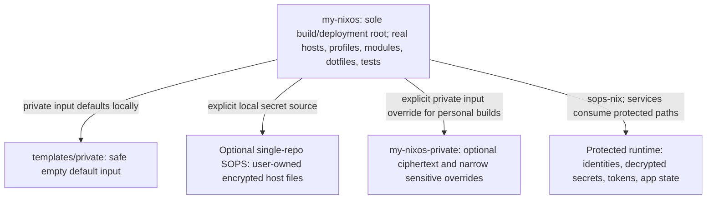

# Public/private migration contract (M01)

Implementation and current commands: [installation and source modes](installation.md).
The dated M01 inventory below remains the historical contract and audit boundary.
[Personal metadata extraction](personal-metadata.md) records the M02.5 ownership changes, neutral Home Manager base and retained/deferred metadata.

Specification for [issue #28](https://github.com/evgen2571/my-nixos/issues/28),
revised to follow the [latest PR #34 review](https://github.com/evgen2571/my-nixos/pull/34#issuecomment-6250388864).
The source inventory and bounded history audit were captured on 2026-10-18 at
`5296a1759e6c1f53e22f55b60400b41c1d25bf4c`.
This is a proposed migration, not a completed split or permission to publish.
M01 changes documentation only. Configuration, ciphertext, generated files and
mutable runtime state stay unchanged; actual templates and wiring belong to M02.

The [architecture](../ARCHITECTURE.md), [module conventions](modules.md),
[SOPS guide](sops.md), [server guide](server.md),
[VPN gateway guide](shared-vpn-gateway.md) and
[namespace guide](network-namespaces.md) remain authoritative operational guides.
Some SOPS prose predates the current files: active declarations use
`secrets/hosts/*.yaml`, not the historical `secrets/vpn/*.yaml`; current policy
also includes admin-only bootstrap documents. Follow executable declarations.

## Ownership and dependencies



Public `my-nixos` remains the complete, understandable, forkable NixOS
configuration and the only ordinary entry point for `nix build`,
`nix flake check` and `nixos-rebuild --flake`. It retains
`nixosConfigurations.{nixos-pc,nixos-lp,nixos-server}`, `flake/hosts.nix`,
`hosts/{pc,laptop,server,common}/`, feature selection and most hardware/dotfiles.
The separate private repository supplies optional data/modules as a flake input;
it does not assemble hosts, export deployment outputs or consume a public builder.

The committed public flake and lock reference only the safe local template and
accessible public dependencies, with no private Git URL or credentials. A public
clone needs neither the private checkout nor a SOPS identity to evaluate/check.
Personal builds start in the public checkout with an explicit input override.
Private flake sources also enter the Nix store: Git privacy does not protect
plaintext credentials from store exposure.

Classifications are policy decisions, not claims that all metadata is secret:

- **Public / documented public:** real hosts, selections, reusable code and
  opinionated dotfiles. Host labels, UUIDs, public keys, locales and display
  layouts are not automatically private. Review their exposure deliberately.
- **Sensitive personal values:** narrow account/project identifiers or private
  topology facts selected for exclusion. Extract only those declarations into
  private host overrides; keep surrounding host/profile/config source public.
- **SOPS ciphertext:** maintainer credentials/recovery identities move to private
  Git; standalone users may keep their own encrypted host files in their fork.
  Recipient metadata is public cryptographic data, but its associations can be
  private. Never decrypt to perform the split.
- **Runtime-only secrets/state:** identities, plaintext credentials, active
  provider tokens and mutable app data outside both repositories. Never read
  secrets into Nix expressions, derivation arguments or logs.

## File migration inventory

`P:` is public `my-nixos`; `S:` is optional `my-nixos-private`; `R:` is protected
runtime state. Same-path destinations retain existing layout. A directory row
covers remaining files after specific rows; braces enumerate existing files.
New paths/templates below are M02 proposals, not files created in M01. Private
host overrides live in `S: hosts/<host>.nix`; these contain sensitive values only,
not copies of public host definitions. Audit values without publishing them.
Ciphertext/recipient moves below describe the maintainer migration; single-repo
users may retain their own `secrets/hosts/*.yaml` and `.sops.yaml` in P under the
explicit local source mode. This does not authorize publishing maintainer data.

| Current path | Proposed repository/path | Classification | Justification | Consumer / migration impact |
| --- | --- | --- | --- | --- |
| `flake.nix` | P: same; S: new data-only flake.nix | Public / sensitive values | P owns inputs and all host outputs | Add optional private input defaulting to templates/private; no reverse dependency |
| `flake.lock` | P: same | Public | P pins public packages and local template | Preserve dependency revisions; never commit personal input override; S needs no dependency lock with the proposed input-free interface |
| `flake/hosts.nix` | P: same | Public | Existing mkHost owns all three hosts | Use extraModules for per-host private module; keep catalog and assembly local |
| `flake/verification.nix` | P: same | Public | Production and synthetic checks belong with public hosts | Test safe default and private-backed variants without moving registrations |
| `flake/{devshells,formatting}.nix` | P: same | Public | Shared development tooling | Run from P |
| `lib/{module-catalog,module-discovery,config-paths}.nix` | P: same | Public | Discovery and source adapters remain authoritative | Preserve default.nix boundary and public-root source resolution |
| `hosts/pc/configuration.nix` | P: same; sensitive identity values only in S: hosts/pc.nix | Public / sensitive values | Real PC definition remains public | Retain boot, stateVersion, groups and core imports |
| `hosts/pc/hardware-configuration.nix` | P: same | Documented public | Hardware facts and filesystem UUIDs are not credentials | Keep real hardware; review exposure, never regenerate for the split |
| `hosts/pc/profile.nix` | P: same; narrow sensitive endpoints/IDs in S: hosts/pc.nix | Public / sensitive values | PC feature selection remains public | Preserve client role, DNS, application registry and primary-user HM settings |
| `hosts/pc/secrets.nix` | P: same; file supplied by S: secrets/hosts/pc.yaml | Public / SOPS ciphertext | Secret consumers and runtime-path declarations are public | Guard absent file safely; retain ownership, modes, neededForUsers and restart units with private input |
| `hosts/laptop/configuration.nix` | P: same; sensitive identity values only in S: hosts/laptop.nix | Public / sensitive values | Laptop definition remains public | Preserve fingerprint/PAM, boot and stateVersion |
| `hosts/laptop/hardware-configuration.nix` | P: same | Documented public | Most hardware configuration stays public | Keep current filesystem/hardware configuration |
| `hosts/laptop/profile.nix` | P: same; narrow sensitive endpoints/IDs in S: hosts/laptop.nix | Public / sensitive values | Laptop feature selection remains public | Preserve client-only routing and primary-user HM settings |
| `hosts/laptop/secrets.nix` | P: same; file supplied by S: secrets/hosts/laptop.yaml | Public / SOPS ciphertext | Declarations stay near consumers | Preserve private-backed password/key paths; safe missing-secret branch required |
| `hosts/server/configuration.nix` | P: same; sensitive authorization values only in S: hosts/server.nix | Public / sensitive values | Server lifecycle and host ownership stay public | Preserve gateway suspend guard and private-backed SSH authorization |
| `hosts/server/hardware-configuration.nix` | P: same | Documented public | Storage/hardware identifiers are reviewed metadata | Keep real mount definitions; no storage redesign |
| `hosts/server/profile.nix` | P: same; narrow sensitive endpoints/IDs in S: hosts/server.nix | Public / sensitive values | Gateway, storage and service selections stay public | Preserve /srv/* boundaries, provider placement and firewall policy |
| `hosts/server/secrets.nix` | P: same; file supplied by S: secrets/hosts/server.yaml | Public / SOPS ciphertext | Public consumers declare gateway credentials | Preserve runtime paths/restarts; missing credentials must not start provider |
| `hosts/common/desktop.nix` | P: same | Documented public | Shared desktop selections are part of complete public configuration | Retain explicit PC/laptop imports and declaration priority |
| `hosts/common/actline-development.nix` | P: same; sensitive aliases only in S host overrides | Public / sensitive values | Shared development feature/trust selection stays public | Keep desktop-only scope; extract only private topology literals |
| `hosts/common/certs/actline-dev-rootCA.pem` | P: same after exposure review | Documented public certificate | Public trust anchor is not a signing key | Retain desktop trust; signing key stays outside Git; sensitive certificate identity would require a narrow private path override |
| `hosts/vpn-public-keys.nix` | P: same after exposure review; sensitive peer associations only in S host overrides | Documented public keys / sensitive values | Public keys do not grant private-key capability | Keep peer bindings identical for personal builds; no rotation for relocation |
| `home/default.nix` | P: same | Documented public | Generic session/state defaults need no migration rename | Preserve home stateVersion and existing module default |
| `modules/system-core/user.nix` | P: same | Public | Primary-user adapter already supports host values | Keep my.primaryUser.home.settings contract |
| `modules/system-core/{common,server}.nix` | P: same | Documented public | Locale/timezone and package defaults may remain opinionated | No neutralization merely because defaults are personal preferences |
| `modules/secrets.nix` | P: same | Public | Generic protected age identity path | Keep sops-nix integration exactly once; never package identity contents |
| `modules/user-dev/ssh.nix` | P: same; sensitive match-block values in S host HM settings | Public / sensitive values | Generic SSH setup remains public | Use native options through primary-user adapter; preserve keepalive and runtime key paths |
| `modules/user-dev/git.nix` | P: same | Public | Identity already parameterized | Sensitive identity/signing metadata supplied through narrow host override when needed |
| `modules/system-services/syncthing.nix` | P: same | Public | No configured device IDs here | Preserve mutable databases and device enrollment |
| `modules/server/` | P: same | Documented public | Server services and storage implementation remain public | Preserve /srv/storage distinction from sibling paths |
| `modules/system-services/network-namespaces/` except migration bundle below | P: same | Documented public | Isolation/recovery are public security behavior | Preserve fail-closed IPv4/IPv6, DNS, lifecycle and role separation |
| `modules/system-services/network-namespaces/migration/{prepare-rollback,rollback,desktop-provider-guard}.sh` | P: same | Documented public | Reviewed rollback bundle supports public tests and operations | Keep intact; execute only with live-operation approval |
| `modules/system-services/vpnbook-wireguard-failover.nix` | P: same | Documented public | Consumes external protected config files | Preserve separation from shared Hide.me route |
| Remaining `modules/`, `packages/`, `pkgs/` | P: same | Public | Reusable integrations and pinned packages | Keep namespaces, relative imports and dependency pins |
| `config/zen/chatgpt-projects.nix` | S: same; P: safe empty example at same path | Sensitive values / public example | Account/project URLs and IDs can expose private metadata | Supply only private pins/project additions via host HM settings |
| `config/zen/profile.nix` | P: same; sensitive fields only in S host HM settings | Public / sensitive values | Keep workspaces and general browser configuration public | Do not duplicate full profile; preserve private-backed UUIDs and non-forcing semantics |
| `modules/user-apps/zen-browser.nix` | P: same | Public | Public browser integration | Merge narrow profile settings without conflicting definitions |
| `config/noctalia/config.toml` | P: same; sensitive location/path fields only in S | Public / sensitive values | Most shell configuration stays public | Use existing configFile only if needed for a minimally derived source; no whole-tree private copy |
| `config/noctalia/v4/{settings.json,plugins.json,user-templates.toml}` | P: same after sensitive-field review | Public / sensitive values | Legacy app config need not move wholesale | Extract only sensitive fields if present; retain opt-in installer and generated-state boundary |
| Remaining `config/noctalia/` | P: same | Documented public | Bars, widgets, templates and pruning are public | Keep PC/laptop variants and selections public |
| `config/niri/sub/{outputs.kdl,workspaces-pc.kdl,workspaces-laptop.kdl}` | P: same | Documented public | Display layout/workspace preferences stay public by default | Extract only demonstrated sensitive literals; never copy full Niri directory to S |
| `config/hyprland/sub/outputs.conf` | P: same | Documented public | Monitor configuration may remain public | Keep existing adapter and source |
| Remaining `config/` including `config/sesh/sesh.toml` | P: same | Documented public | Most dotfiles remain public; sesh uses home-relative paths | Review future URLs/absolute paths for sensitive content |
| `config/fish/conf.d/openrouter.fish` | P: same | Public | Reads runtime API secret, contains no key | Preserve protected runtime path; never substitute credential contents |
| `config/fish/conf.d/nixos-hosts.fish` | P: same | Public | Build/deployment helpers operate from P | Document explicit private override; do not silently send personal deployment through empty default |
| `.sops.yaml` | S: same; P: templates/private/README.md policy example | Sensitive recipient associations | Recipient rules accompany private ciphertext | Keep rules/recipients unchanged; no rekey for same paths |
| `secrets/hosts/pc.yaml` | S: same | SOPS ciphertext | Admin + PC recipients | Public declaration uses private input file path; no decrypt/re-encrypt |
| `secrets/hosts/laptop.yaml` | S: same | SOPS ciphertext | Admin + laptop recipients | Public declaration uses private input file path |
| `secrets/hosts/server.yaml` | S: same | SOPS ciphertext | Admin + server recipients | Preserve refreshed runtime provider token |
| `secrets/bootstrap/pc.yaml` | S: same | SOPS ciphertext | Admin-only recovery identity material | Do not expose to host recipients or include in host secret-file map |
| `secrets/bootstrap/laptop.yaml` | S: same | SOPS ciphertext | Admin-only recovery identity material | Keep recovery separate |
| `secrets/bootstrap/server.yaml` | S: same | SOPS ciphertext | Admin-only recovery identity material | Keep recovery separate |
| `secrets/{README.md,.gitkeep,hosts/.gitkeep}` | P: policy/placeholders; S: ciphertext storage guidance | Public | Policy stays useful publicly | Correct file-location claims; P no longer carries personal ciphertext at HEAD |
| `keys/users/example-user/{pc.pub,laptop.pub}` | P: same after exposure review; sensitive associations only in S | Documented public keys / sensitive values | Public login keys are not private keys | Preserve server authorization exactly with private input; no rotation for relocation |
| `keys/{README.md,hosts/.gitkeep}` | P: same | Public | Public-key policy and placeholder | No private key added |
| `tests/niri/hosts.nix`, `tests/network-namespaces/hosts.nix` | P: same | Public | Real-host behavior remains publicly owned/tested | Keep production assertions with private input; explicitly test safe absent-material mode too |
| `tests/network-namespaces/activate-laptop.sh` | P: same after sensitive-literal review | Documented public | Operational helper need not move with secrets | Approval-only; adapt explicit private override before future use |
| `tests/network-namespaces/prepare-shared-rollback.sh` | P: same | Public | Generic rollback caller | Preserve intact public migration bundle and runtime paths |
| Remaining `tests/` including `tests/network-namespaces/{systemd.nix,public-keys.nix}` | P: same | Public | Synthetic VM coverage stays public | Fixture private keys remain runtime-generated, never production credentials |
| `justfile` | P: same | Public | Real build/deploy entry point stays public | Keep real host aliases; document/forward explicit override without implicit private discovery |
| `docs/archive/{server-initial-setup-notes,shared-vpn-gateway-implementation-plan,shared-vpn-initial-rollout-runbook}.md` | P: same after sensitive-literal review; private extracts only in S: docs/ | Public / sensitive values | Operational history need not disappear from public | Keep useful history, redact narrowly and fix links; archives are not current truth |
| `.agent/vpn-resilience-plan.md` | P: same after sensitive-literal review | Public / sensitive values | Planning history is not inherently private | Extract only sensitive incident facts; no implementation dependency |
| `docs/{desktop-host-defaults,obsolete-configuration-audit}.md` | P: same after sensitive-literal review | Documented public | Host selection and architecture remain public | Preserve useful inventories and links |
| `docs/{server,shared-vpn-gateway,network-namespaces,sops,zen-browser}.md` | P: same; sensitive operational values only in S: docs/ | Public / sensitive values | Daily workflows and public host operations stay documented | Commands run from P; do not duplicate guides privately |
| `README.md`, `AGENTS.md`, `ARCHITECTURE.md`, `docs/{modules,task-routing}.md`, `docs/agents/` | P: same | Public | Public repository remains the complete configuration | M02 documents optional input, templates and unchanged entry point |
| `docs/public-private-migration.md` | P: same after final exposure review | Public contract | Ownership and migration design should be understandable publicly | Keep contract; extract any sensitive audit evidence rather than moving entire inventory |
| Remaining `docs/`, `.gitignore`, `.clang-format` | P: same after link/value review | Documented public | Guidance/tooling remains public | No blanket username replacement or documentation migration |
| New `templates/host/{configuration.nix,profile.nix,README.md}` | P: new in M02 | Public examples | Forkable host through existing assembly | Use caller hardware/identity, explicit state versions and safe credential defaults |
| New `templates/private/{flake.nix,README.md,hosts/}` | P: new in M02 | Public examples | Tracked nested flake is default private input | Empty maps by default; optional empty/narrow host override example, no ciphertext or fake production credentials |
| Git author/committer identities, old paths and deleted revisions | Existing restricted history until publication decision | Metadata / possibly credential-bearing history | Deleting HEAD files does not erase history | Apply separate history scan and publication gate |
| `/var/lib/sops-nix/key.txt`, admin age identity, private SSH/CA/WireGuard keys | R: existing protected locations | Runtime-only secrets | Actual decryption/authentication capability | Never inspect/copy into Nix expressions, source or logs |
| `/run/secrets*`, provider bootstrap/refresh tokens, external VPNBook configs | R: existing protected locations | Runtime-only secrets | Decryption output and active credentials | Preserve owners/modes; no token replacement for repository split |
| Browser logins/databases, Skillshare resources, Syncthing state, `/srv/*` data, VPN hold/lifecycle state | R: existing locations | Runtime-only state/secrets | Mutable app/host data is not source | Back up privately where appropriate; never delete because imports moved |

## Minimal composition contract for M02

Keep the existing local `mkHost` function in `flake/hosts.nix` and
its desktop/server catalog profiles. No exported builder, core-module aliases,
private wrapper host assembly or new host-definition framework is required.
The public flake adds one input (proposed syntax tested below):

```nix
inputs.private.url = "path:./templates/private";
```

Use two small data outputs from that input:

- `nixosModules`: optional modules keyed by existing source host names
  (`pc`, `laptop`, `server`); absent entries mean an empty module.
- `secretFiles`: optional SOPS ciphertext paths keyed by the same host names;
  absent entries mean no private credentials. Bootstrap documents are not exposed
  through this map. A provided path must exist and be encrypted; invalid supplied
  material must fail validation, not silently fall back to empty mode.

The safe `templates/private/flake.nix` has no dependencies or host outputs:

```nix
{
  outputs = { self }: {
    nixosModules = {};
    secretFiles = {};
  };
}
```

A real private flake implements exactly that interface, for example:

```nix
{
  outputs = { self }: {
    nixosModules = {
      pc = ./hosts/pc.nix;
      laptop = ./hosts/laptop.nix;
      server = ./hosts/server.nix;
    };
    secretFiles = {
      pc = ./secrets/hosts/pc.yaml;
      laptop = ./secrets/hosts/laptop.yaml;
      server = ./secrets/hosts/server.yaml;
    };
  };
}
```

No private `nixosConfigurations`, public input or duplicate nixpkgs/Home Manager/
sops-nix lock is needed. Public `flake/hosts.nix` uses its existing `extraModules`
argument to include `(inputs.private.nixosModules.pc or {})` for PC, analogously
for laptop/server. Existing `specialArgs.inputs` and HM `extraSpecialArgs` already
forward the public inputs. In private mode, public `hosts/<host>/secrets.nix`
consumes `inputs.private.secretFiles.<host> or null`; local mode uses the tracked
public-root host ciphertext path. Include private host modules only in private
mode. Keep source selection at the public host boundary, available before import
resolution; do not select imports recursively through `config`.
The real private flake supplies only narrow sensitive declarations and ciphertext
paths. Public hosts still own all feature selections and their local imports.

The public builder continues importing Home Manager, sops-nix and
`modules/secrets.nix` exactly once. Core modules retain explicit public host
imports; discovered NixOS/HM roots retain catalog ownership and
`home-manager.sharedModules`. Preserve all `my.*` namespaces and
`my.primaryUser.home.settings`. Do not use `mkForce` wholesale to cover duplicate
host/profile definitions: extract individual sensitive declarations from P and
supply them once in S, retaining public defaults only where safe and useful.

For dotfiles, keep public content and host variants in `config/`. Use existing
native HM options for small private additions (for example private Zen pins), or
a narrowly derived file through an existing config-path option where an app
requires a whole file (for example Noctalia `configFile`). Compose that file from
public source plus sensitive fields; do not maintain a private copy of the public
configuration tree. If a leaf mapping needs adjustment, change only the affected
mapping in M02 and verify effective targets. Do not repoint entire Niri/Hyprland
source directories to S. Preserve writable Neovim/Matugen, Noctalia generated
settings, browser state and Skillshare resources.

### Supported modes and secret-source selection

All three modes use the same public host assembly, consumer declarations and
protected sops-nix runtime paths. The private interface remains the two maps
above; local SOPS needs no second flake or repository.

| Explicit per-host source | Supported use | Selected ciphertext |
| --- | --- | --- |
| `none` | Standalone public configuration, including secretless new-host installation | None; credential-dependent features unavailable |
| `local` | Single-repository SOPS with user-owned recipients and ciphertext | Public-root `secrets/hosts/<host>.yaml`, with user-managed `.sops.yaml` |
| `private` | Maintainer's personal setup via explicit private input override | Only `inputs.private.secretFiles.<host>` plus its narrow host module |

Keep the choice explicit in the owning public host configuration using the
smallest existing host-setting pattern in M02, not a new provider interface.
`templates/host/` chooses `none`; existing PC/laptop/server choose `private` and
require private material for deployment. Never infer source from file existence,
runtime credentials, hostname detection or which repository happens to be nearby.

Missing or unknown source choices are validation errors. Selection is exclusive,
with no fallback or cross-source merging:

- `none` consumes no ciphertext or private module, even if local files or a
  populated private input exist. Selecting `none` must be deliberate; it cannot
  remove the deployment requirement on an existing production output.
- `local` requires the selected tracked encrypted host file and matching
  recipient policy; a missing, malformed or incomplete source fails validation.
  It never fills missing data from the private input.
- `private` never reads local ciphertext, including stale copies. A missing entry
  in the safe empty template permits public-only evaluation in the unavailable
  state below, but fails production deployment preflight. A supplied invalid
  path, malformed file, missing required field or incomplete personal override
  fails validation; it cannot select `local` or become an operational `none`.
- If both sources are present, the explicit choice selects exactly one; the other
  is ignored and reported as unselected in validation diagnostics without secret
  values. With no explicit choice, contradictory sources are an error, not a
  precedence rule. Changing sources requires a reviewed host edit and validation.

### Secretless installation versus production deployment

A new host copied from `templates/host/` must support installation in `none`
mode without SOPS or a private repository. Before installation, the operator must
configure and validate a secure first-login route: their own authorized SSH
**public** key with explicitly configured reachable SSH, or controlled console
password provisioning outside Git and the Nix store. Refuse installation if no
usable route is configured. Ship no usable default/empty password, public password
hash, automatic login or automatic firewall opening. Keep password login locked
when using key-only access. Do not silently change `users.mutableUsers` on existing
hosts to enable the new-host workflow.

For `nixos-pc`, `nixos-lp` and `nixos-server`, successful public-only evaluation,
checks or a non-activating build is not deployment readiness. M02 must enforce a
preflight that refuses install, switch or boot-generation selection without the
required private ciphertext, sensitive overrides and protected runtime identity
(or an explicit secure identity-provisioning step for installation). It must
reject partial material and source substitution before live state changes,
including direct deployment commands as well as `just`/Fish helpers; documenting
an optional wrapper alone is insufficient. A normal invocation cannot activate a
secretless generation on these outputs. Any deliberate secretless recovery needs
a separately approved, explicit recovery procedure, not silent fallback or an
automatically inferred exception.

M02 must implement and test the unavailable-material branch at the consumers:

- Do not evaluate nonexistent SOPS file paths or reference undeclared secrets.
  Keep declarations/key names, owners, modes, `neededForUsers` and restart units
  unchanged when the selected valid source is supplied.
- Without a password secret on an existing host, keep the account locked, with no
  empty/default password or fallback SSH access. The new-host first-login method
  above is an explicit installation choice, not a fallback for existing hosts.
- Without VPN keys/provider credentials, prevent credential-dependent transport
  and provider services from starting. Retain namespace containment, firewall,
  DNS and selected-app fail-closed behavior, including when credentials disappear
  after a previously configured generation. A failed selected-app launch cannot
  fall back to host networking. Missing private endpoints/keys cannot become
  permissive peers or placeholder production credentials.
- Do not silently disable the namespace security boundary or substitute another
  provider. Ordinary host networking remains independent. Surface unavailable
  features in documentation and diagnostics, preserving public feature intent
  (desktop clients, server gateway and shared selections).
- With real private input, compare the exact existing operational behavior for
  every host. Validate missing, partial, malformed and conflicting sources, plus
  the new-host first-login route and existing-host deployment refusal in isolation.

### Documented templates

M02 creates one public `templates/` directory:

```text
my-nixos/                       # sole build/check/deployment root
  flake.nix  flake/hosts.nix
  hosts/{pc,laptop,server,common}/
  modules/  config/  lib/  tests/  docs/
  templates/
    host/
      configuration.nix
      profile.nix
      README.md
    private/
      flake.nix                 # empty interface above; committed default input
      README.md
      hosts/                    # optional empty/narrow module example
my-nixos-private/               # optional sibling, never the build root
  flake.nix
  hosts/                        # sensitive overrides only
  secrets/                      # SOPS ciphertext only
  .sops.yaml
```

`templates/host/README.md` documents copying into `hosts/<new-host>/`, supplying
hardware configuration, choosing identity and explicit state versions, and adding
a `mkHost` call to existing public assembly with the appropriate catalog profile.
It must not require maintainer-private modules, keys, recipients or credentials.
Document `none` as the new-host source, the mandatory first-login preparation,
and optional `local` SOPS setup in the same checkout.
`templates/private/README.md` documents the interface, source tracking, encrypted
file policy, safe empty behavior and public-root override commands below. It may
show sanitized recipient-rule examples; the default includes no production SOPS
file, account secret or private Git URL. Git does not track empty directories:
track any example module deliberately. Do not create `private-example/`.

## Public-alone validation and personal composition

Keep all existing check registrations in P, including `niri-host-profiles` and
`shared-vpn-host-profiles`. Preserve their current production assertions when
private input is supplied; add explicit missing-material assertions for the safe
default, rather than skipping the VPN checks or deleting secret-path assertions.
Keep synthetic namespace/systemd/launcher/recovery tests, runtime-generated test
keys, config-path tests and Neovim smoke sources public. No extra CI framework.

M02 acceptance matrix (all commands start in public `my-nixos`):

| Mode | Required evidence |
| --- | --- |
| Clean public clone, private checkout absent, no private Git authentication | All three outputs evaluate; default local input resolves; lock unchanged; evaluation and full public checks pass |
| Single-repository SOPS (`local`) | Tracked user-owned ciphertext and recipient policy work without private repository access; runtime identity, permissions and source selection validated |
| Real private input override (`private`) | All three outputs evaluate and build non-activating; public production checks pass; semantic security/HM comparisons match baseline |
| Missing, partial, malformed or conflicting sources | Exclusive selection, no stale-source fallback; explicit validation failure or safe evaluation-only unavailability; production deployment refused without required private material |
| Fork/new host from templates/host (`none`) | Register/evaluate/build with existing mkHost; isolated installation proves secure first login without maintainer-private access; missing login configuration refuses installation |
| Existing hosts without required private material | Public evaluation/checks still work; preflight refuses install/switch/boot via direct commands and helpers before live state changes |

Public-alone commands:

```sh
nix flake show --no-write-lock-file
nix flake check --no-build --no-write-lock-file
nix flake check --no-write-lock-file
nix eval --raw .#nixosConfigurations.nixos-lp.config.system.build.toplevel.drvPath \
  --no-write-lock-file
```

Repeat the last command for PC and server. The second command evaluates checks;
the third executes/builds registered checks including supported VM tests.
Neovim smoke tests remain a separately provisioned local check. Test the actual
tracked nested template and public lock in a clean clone on supported Nix
versions; no absolute local paths, private lock nodes or inaccessible remote
fetches are permitted. Offline input-resolution tests may use a populated public
package cache; distinguish public dependency downloads from private access.

### Input-resolution probe performed for M01

A disposable Git fixture on Nix 2.34.8 used the literal
`path:./templates/private` input above and an input-free nested flake. After
committing the template and generated root lock, a clean clone passed offline
`nix eval` of the empty interface and `nix flake check --no-write-lock-file`.
The lock recorded `path = "./templates/private"` and `type = "path"` in both
original/locked records, with `parent = []` on the private input node.
An explicit `--override-input private git+file:///ABSOLUTE/PRIVATE/CHECKOUT
--no-write-lock-file` selected a different tracked host-module map and passed
evaluation/checks; the root lock stayed byte-identical and Git status stayed
clean. Repeating evaluation/checks with `?rev=COMMIT` pinned to the fixture
private commit also passed without changing the root lock. This tests path
resolution and override selection, not NixOS composition,
service behavior, production checks or compatibility with older Nix versions.
M02 must repeat against the real tracked layout and declare/test its supported
Nix version; do not generalize the probe into migration completion evidence.

## Daily development and reproducible inputs

Use a private sibling checkout only when sensitive material is needed. Before
any private push, verify owner/name and visibility with
`gh repo view OWNER/my-nixos-private --json nameWithOwner,isPrivate,visibility`.
The original repository was verified PRIVATE during the initial audit; no new
repository or visibility change is made in M01. Use Git credentials through an
SSH agent/helper, never embedded in URLs, source or lock files.

1. **Add a module and enable it on PC:** edit `modules/...` in P using the nearest
   module pattern; enable its existing `my.*` option in public
   `hosts/pc/profile.nix`. Discovery imports it through the existing catalog;
   no private edit is needed unless the feature needs new sensitive values.
2. **Edit an app dotfile:** edit public `config/` and run the subsystem checks.
   Keep public Niri/Noctalia/Zen choices here. Extract only sensitive fields;
   do not create parallel private app trees. A personal build still starts in P.
3. **Change a local SOPS secret:** explicitly select `local` for the user's host,
   manage their own `.sops.yaml` recipients and encrypted
   `secrets/hosts/<host>.yaml` in P, then stage the ciphertext. Evaluate/check/build
   from P without a private override. Provision the host age identity separately
   at its protected runtime path; neither it nor decrypted contents enter Git or
   the store. Review ciphertext metadata before any public push.
4. **Change a personal private secret or identifier:** edit S, using SOPS from S
   for encrypted documents (never print decrypted values). Keep recipient policy
   and recovery restrictions intact. Stage intended files, then evaluate/check/
   build from P in `private` mode with the explicit override below.
5. **Fork/add a host:** copy `templates/host/` into `hosts/<new-host>/`, provide
   hardware, identity and secure first-login access, and register it in public
   `flake/hosts.nix`. Stage files before evaluation. Use explicit `none` for
   secretless installation; later opt into `local` or an optional private flake
   without changing the public build root.

For local personal development, run these proposed M02 commands from P.
`git -C` resolves the sibling to an absolute path without broadening the Git
source filter to untracked files:

```sh
private_checkout=$(git -C ../my-nixos-private rev-parse --show-toplevel)
nix eval --raw .#nixosConfigurations.nixos-lp.config.system.build.toplevel.drvPath \
  --override-input private "git+file://$private_checkout" --no-write-lock-file
nix flake check --no-build \
  --override-input private "git+file://$private_checkout" --no-write-lock-file
nix flake check \
  --override-input private "git+file://$private_checkout" --no-write-lock-file
nix build --no-link .#nixosConfigurations.nixos-lp.config.system.build.toplevel \
  --override-input private "git+file://$private_checkout" --no-write-lock-file
```

Repeat for `nixos-server` and `nixos-pc`. Local Git flakes include tracked edits
but omit untracked/ignored files; stage new templates, modules and ciphertext.
Avoid `path:` overrides of personal checkouts because they copy untracked files
more broadly. Do not use impure sibling imports or auto-detect private checkouts.
Public source remains the current P checkout; it needs no input override of its
own. Existing `just` aliases and Fish helpers stay public; until explicit private
flag forwarding is implemented/tested in M02, use these direct commands for
personal builds/deployment. Never assume an alias selected the personal input.

For a reproducible release, commit both trees, record the P commit and exact S
commit privately, and repeat checks/builds with
`--override-input private "git+file://$private_checkout?rev=PRIVATE_COMMIT"` and
`--no-write-lock-file`. Replace `PRIVATE_COMMIT` with the reviewed commit hash;
keep it available in the private checkout. P's committed lock stays on the local
empty template; do not run `nix flake update private` to record the personal
source. Review `git status` and `git diff -- flake.lock` before every public
commit. Private input revisions belong in protected release evidence, not a
public lock or a second deployment flake.

Only after separate live-activation authorization, the deployment command also
starts from the reviewed P checkout and selects the same private revision:

```sh
sudo nixos-rebuild switch --flake .#nixos-lp \
  --override-input private "git+file://$private_checkout?rev=PRIVATE_COMMIT" \
  --no-write-lock-file
```

This is a documented future command, not executed by M01. M02 must verify
`nixos-rebuild` flag forwarding and privileged access to the source on the target
host before use; no credentials should be placed in command arguments. Public
safe-mode evaluation cannot bypass the mandatory existing-host deployment
preflight described above.

## History audit and publication gate

M01 inspected all 365 commits reachable from local refs in a non-shallow checkout
and 1,343 distinct reachable blobs (about 4.4 MB). A bounded pattern scan checked
private-key markers, common provider token shapes and literal credential
assignments without printing matched values. Six assignment candidates were
triaged as runtime path references, including the VM token-file path. A separate
check of 16 historical YAML blobs found 44 encrypted top-level fields and one
empty field, with no nonempty plaintext top-level secret fields. Current six
secret documents have encrypted data fields; bootstrap files have one recipient,
host files two, matching the inspected policy. Nothing was decrypted. No
confirmed plaintext credential was found by these checks.

This is **not security clearance**: pattern scans miss arbitrary credentials,
nested data and unusual formats; local refs exclude unfetched/deleted remote
refs, PR refs, forks, artifacts and caches. Public SSH/WireGuard keys, CA
certificates, SOPS recipients/ciphertext, filesystem UUIDs, tailnet addresses,
account/project URLs and Git author/committer identities are separate metadata
exposure classes. Moving HEAD files does not hide any historical versions.
Historical `secrets/vpn/*.yaml` and older public-key paths also need history policy.
Do not reintroduce those obsolete paths during the move.

Keep the existing `my-nixos` repository identity and public build ownership.
Before changing visibility, review every retained metadata class deliberately,
including the public host/hardware/key choices in this inventory. Extracting
ciphertext and a few values at HEAD does not sanitize older commits. The revised
contract/inventory can remain public after exposure review; raw audit evidence
and private release records stay restricted.

Decide history policy separately: retain reviewed existing history only after
an adequate full-ref audit, or authorize a scoped history cleanup with restricted
backup and a force-push/reclone plan. A new-root snapshot is another option only
with explicit owner approval; it is not a prerequisite or an automatic repository
replacement. No history rewrite, visibility change or publication is authorized
by M01/M02. Include branches/tags/PR refs, release attachments, issues, actions
artifacts/logs and cached copies in the follow-up audit. Check the eventual public
flake/lock for private paths/URLs and the full public snapshot for sensitive
values, without removing public host ownership to avoid the review.

If an actual credential is found, stop publication and report only location/type
through a private channel; never paste values/raw matches into Git/issues/PRs.
Privately revoke/rotate and assess use first. History cleanup cannot revoke
copied credentials. Public keys/certificates alone do not require rotation;
loss of a private key does. Recipient changes require SOPS rekey review and cannot
revoke old ciphertext. Relocation itself requires neither rotation nor rekeying.

## M02 implementation, validation and rollback

Coordinate public and private changes on feature branches. P owns template/input
wiring, all host assembly/selections, safe missing-material handling, tests and
docs. S owns only encrypted documents and narrow sensitive overrides. Do not
close M02 with mismatched interfaces or unvalidated personal deployment commands.

1. [ ] Follow the current implementation responsibilities linked below. Record
   clean/dirty state, exact P baseline and lock hash; verify S visibility before
   any sensitive push. Use existing protected backup/recovery procedures without
   reading identities or mutable data into audit output.
2. [ ] Capture all three current hosts' option/derivation snapshots in a mode-0700
   evidence directory outside both repos (`umask 077`). Include Nix versions,
   primary user, state versions, boot/mounts, service selection, namespace roles,
   firewall/DNS, public-key bindings, secret paths/permissions and HM leaf targets/
   activation ownership. Keep raw metadata/private identifiers out of public logs.
3. [ ] Add tracked templates and the optional input to P; keep all real outputs,
   shared profiles, core imports and catalog discovery. Add small contract tests
   for all three source modes, exclusive selection, ciphertext paths and partial/
   invalid/conflicting input. Test credential loss, new-host first login and
   existing-host deployment preflight through direct commands and helpers. Keep
   production assertions, not unconditional skips.
4. [ ] Copy only inventory-selected ciphertext/values to S; verify byte hashes,
   recipients and relative SOPS paths privately. Keep bootstrap documents admin-
   only. Remove corresponding sensitive literals/ciphertext from P's final HEAD
   only when a compatible S revision exists. Do not re-encrypt or touch live state.
5. [ ] From P with explicit private override, evaluate/build **server first**
   (gateway-only provider, storage boundaries, sleep guard, SSH, runtime paths),
   **laptop next** (client-only transport, PAM/login, HM/browser identities), then
   **PC** (client-only transport, boot/NVIDIA, displays and HM). This is a
   non-activating validation order; keep the live gateway untouched.
6. [ ] Compare snapshots semantically. Store/source hashes may change; account
   for every change in generated units, firewall/DNS, SSH, mounts, credentials'
   paths/modes/restart units, state versions and HM targets/activation. Verify
   no new plaintext credential exposure in closures/units without printing
   secrets. Preserve refreshed tokens, writable app state and provider guard.
7. [ ] Run no-secrets, single-repo SOPS and private-overridden evaluation/full
   flake checks,
   non-activating builds of all affected hosts, applicable Neovim smoke checks
   and dedicated namespace tests. Test unavailable-secret behavior in isolation.
   Document actual failures/skips. Validate new-host template and exact personal
   commands, including pinned private revision and rebuild flag forwarding.
8. [ ] Commit compatible S first and record its revision privately; validate P
   against it with explicit override and unchanged public lock. Merge coordinated
   changes only with a usable intermediate state (prepare S before P starts
   relying on it). Retain original restricted checkout and baseline generations.
   Test a fresh P clone with S absent and no private authentication; inspect its
   lock for local template resolution and no accidental private dependency.
9. [ ] Live rollout requires separate approval, console/SSH recovery, backups
   and VPN rollback controls. If approved, use per-host health gates and a second
   SSH session; stop on isolation, authentication, storage or ordinary networking
   regressions. Publication remains a separate gate.

Before/after commands run from P for each existing output; after extraction,
append the explicit private override and `--no-write-lock-file` from the daily
workflow. Redirect snapshot stdout/stderr to the protected evidence directory:

```sh
nix eval --raw .#nixosConfigurations.HOST.config.system.build.toplevel.drvPath
nix eval --json .#nixosConfigurations.HOST.config.system.stateVersion
nix eval --json .#nixosConfigurations.HOST.config.my.system.services.networkNamespaces
nix eval --json .#nixosConfigurations.HOST.config.sops.secrets
nix build --no-link .#nixosConfigurations.HOST.config.system.build.toplevel
```

Replace `HOST` with `nixos-server`, `nixos-lp` or `nixos-pc`. Namespace/SOPS
metadata must contain runtime references only, never secret contents. Do not
publish raw snapshots or use derivation-path equality as the only check.

Before activation, rollback means returning P to the last known-good commit/lock
and selecting its compatible S revision explicitly, or using the original
restricted checkout. The build root stays P. Do not remove private ciphertext,
identities or runtime state. After separately authorized activation, restore the
saved known-good generation from independent host SSH/console using the VPN
rollback runbook. Do not roll clients back to historical local-provider behavior:
retain the persistent desktop-provider guard. NixOS rollback does not restore
mutable tokens/databases or clear masks. Never rewrite history for rollback.

### Current follow-up responsibilities

The following issues have been updated to the approved public-first contract:

- [M02 (#29)](https://github.com/evgen2571/my-nixos/issues/29): implement templates,
  the unchanged minimal private interface, three source modes, safe consumers and
  mandatory existing-host deployment preflight, preserving host behavior.
- [M03 (#30)](https://github.com/evgen2571/my-nixos/issues/30): validate three-host
  parity, all source modes, first-login/bootstrap/recovery and deployment readiness;
  document standard standalone installation without requiring disko/nixos-anywhere.
- [M06 (#33)](https://github.com/evgen2571/my-nixos/issues/33): optional later
  nixos-anywhere provisioning for the same three modes, with isolated install
  tests, secure first access and explicit destructive-operation gates.

PR #34 remains documentation-only; implementation belongs to #29. These issues
provide no authorization for live operations or publication.

Non-goals: broad layout/namespace refactors, exported host frameworks, dependency
updates, new CI infrastructure, VPN/DNS/provider redesign, storage redesign,
secret rotation, actual file migration, history rewriting, publication or live
activation in this PR.

## M01 validation boundary

This revision checks documentation links/current inventory paths, Markdown
structure, requirements consistency and diff whitespace. The earlier disposable
input-resolution probe remains dated evidence only; this final revision does not
execute the proposed source-selection or deployment behavior. The bounded history
audit is retained as dated evidence, not rerun or promoted to publication
clearance. No production NixOS evaluation/build, VM suite, decrypted-secret
inspection or runtime health test is implied. M02 must implement the actual
templates/wiring and produce its own clean-clone, semantic comparison, full-check
and non-activating build evidence before deployment/publication is considered.
