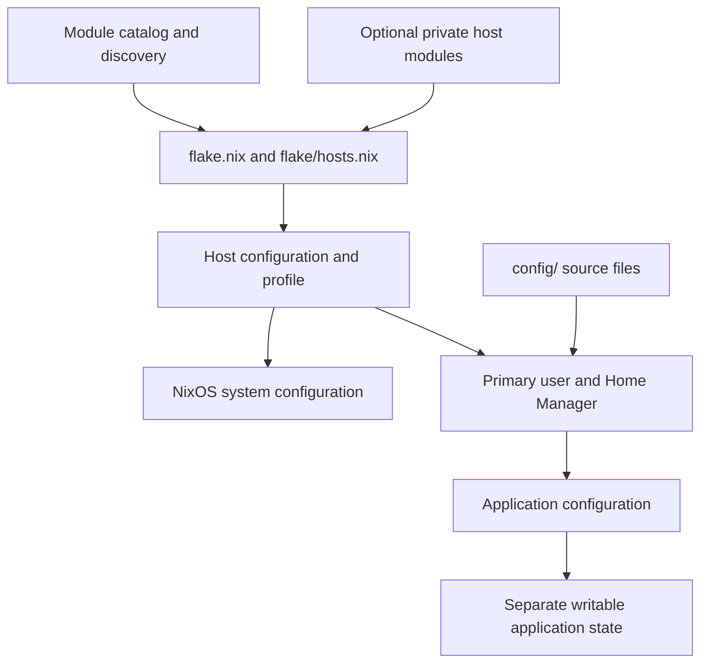

# Architecture

The public repository assembles all three hosts. Host profiles select features;
NixOS and Home Manager modules implement them; `config/` holds application source
files. The optional private input supplies sensitive values and encrypted files.
When a guide disagrees with the Nix source, verify the source before changing behavior.

## Layers

| Location | Responsibility |
| --- | --- |
| `flake.nix`, `flake/` | Inputs, host assembly, checks, formatter, development shell |
| `lib/package-sources.nix` | Package selections outside the default stable package set, with scoped dependency fixes |
| `hosts/<host>/configuration.nix` | Hardware, boot, machine identity, base imports |
| `hosts/<host>/profile.nix` | Feature selection and machine-specific settings |
| `hosts/common/desktop.nix` | Shared PC/laptop selections, explicitly imported by both profiles |
| `modules/{ai,apps,desktop,dev,files,hardware,server,services}` | Feature categories with typed NixOS/Home Manager entries |
| `modules/core` | Explicit desktop/server and primary-user/Home Manager baselines |
| Legacy namespace and deployment entries | Remaining #54 migration; see [refactor progress](../refactor/complex-features.md) |
| `config/` | Program-native source configuration |
| `lib/config-paths.nix` | Source-to-runtime mappings, including host variants |
| `tests/` | Automated checks and smoke tests |

`flake/hosts.nix` uses `nixpkgs.lib.nixosSystem` with Home Manager and sops-nix.
The module catalog supplies system modules and `home-manager.sharedModules` for
either a desktop or server profile. Discovery makes a module available; the
host still chooses whether to enable its feature. See [modules](modules.md).

The primary-user adapter in `modules/core/primary-user.nixos.nix` imports
`modules/core/primary-user.home.nix` and applies
`my.primaryUser.home.settings` to the selected Home Manager user. Keep host-specific user selections at that boundary.

Shared desktop declarations retain ordinary Nix priority. If a selection stops
being common to both machines, move it back to the profiles or choose an explicit
override. The workstation bundle uses `mkDefault` for its overridable features.
Hardware declarations and security-sensitive host selections remain local.

## Public and private configuration

The public repository remains the only build and deployment root. Private inputs
export `nixosModules` and `secretFiles` maps keyed by host. They do not build a
second set of hosts or duplicate application trees.

Keep packages, layouts, feature choices, generic routing, and hardware configuration
public. Private overrides supply personal account/Git settings, location and
timezone, work aliases and CA trust, browser project associations, and SSH/VPN
peer associations. Credentials belong in encrypted SOPS documents or protected
runtime files. A private Git repository still enters the Nix store: never put
plaintext credentials or private keys into its Nix expressions.

Source modes `none`, `local`, and `private` are selected explicitly before module
imports, without automatic sibling detection or fallback. The empty tracked
private input permits public evaluation. Production outputs require private
material for deployment and retain their guards. See [secrets](../operations/secrets.md)
and [deployment](../operations/deployment.md).

## Source files and writable state

Home Manager owns only the files its modules declare. The live application
directory can also contain generated files, sessions, databases, and caches.

- Neovim activation copies sources with `rsync`, preserving generated
  `lua/matugen.lua`. The resulting configuration remains writable.
- Noctalia combines source settings with runtime state and generated themes.
  Niri loads generated Noctalia KDL alongside source files.
- Zen manages selected settings and pins while the browser owns sessions and logins.
- Skillshare resources remain writable; Nix installs its executable only.

Preserve these boundaries when changing deployment. A whole-directory immutable
link or cleanup step could overwrite application-owned state. NixOS rollback
restores system configuration, not application databases or secret identities.

## Networking and server data

The server hosts the Hide.me gateway. Selected desktop applications run in
isolated WireGuard namespaces carried over Tailscale to that gateway. They fail
closed when the protected route is unavailable. Ordinary desktop networking,
SSH, and Docker keep their normal routes. See [VPN](../operations/vpn.md).

Server paths such as `/srv/compose`, `/srv/appdata`, `/srv/backups`, and
`/srv/secrets` are not implicitly on `/srv/storage`. Mount dependencies and
backup coverage need explicit configuration. Syncthing replication is separate
from backup. See [server operations](../operations/server.md).
